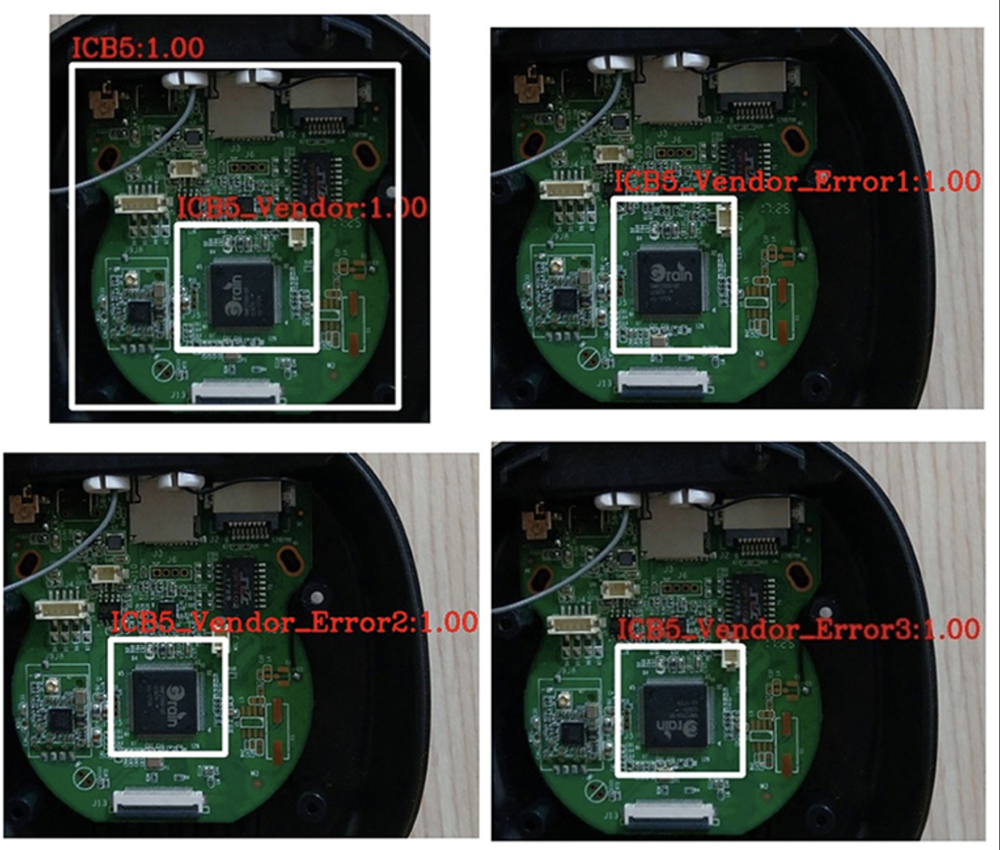
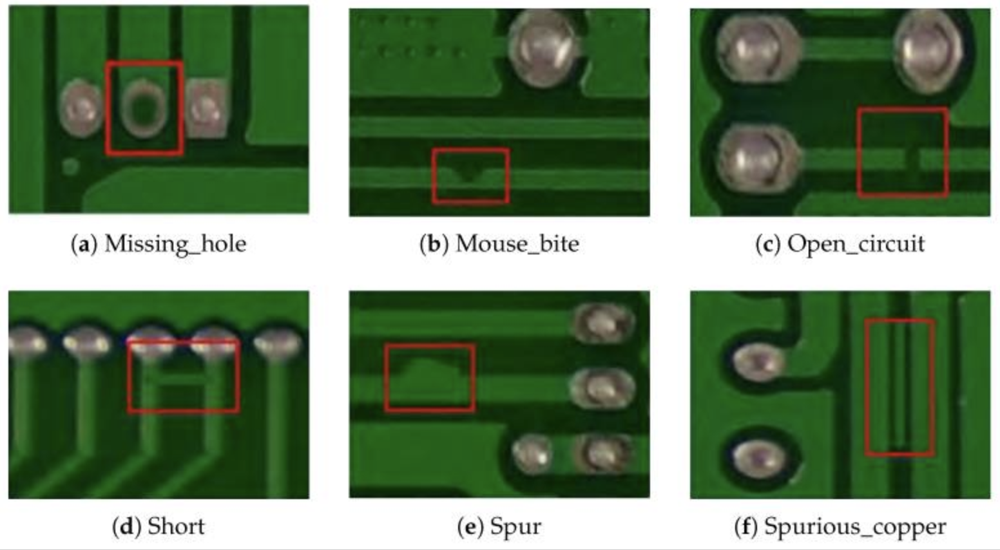
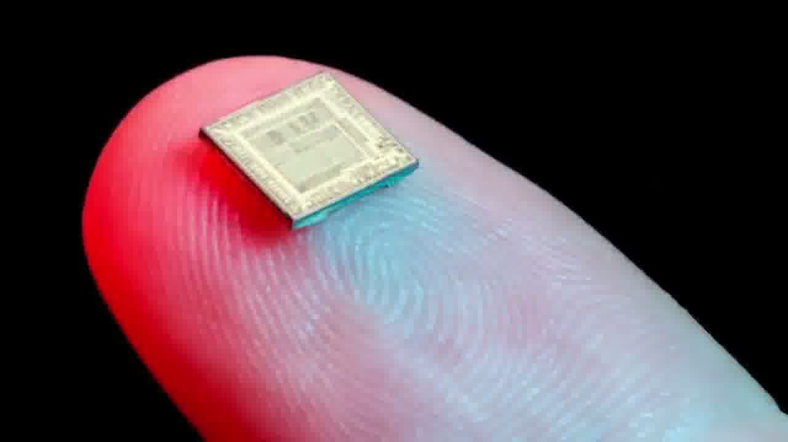
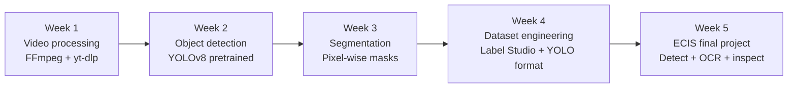
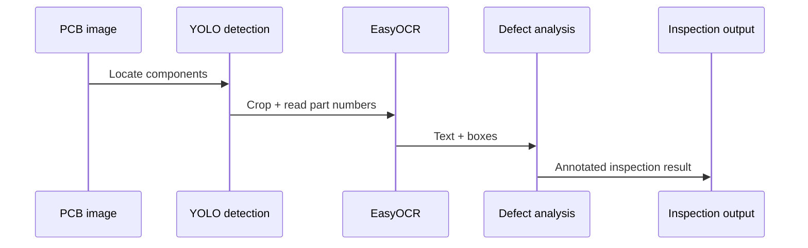

<!--
  DRAFT ONLY — for the readme-revamp branch. Not committed, not pushed.
  Evidence rules applied: every claim traces to a file in this repo.
  Anything not evidenced is marked <!-- TODO: ... --> and listed in
  "What I still need to add" below.
-->

<!-- Hero banner (renders as an image on GitHub; the H1 + tagline below
     it are the plain-text fallback, so the page still reads if the
     widget ever fails to load.) -->
<p align="center">
  
</p>

<h1 align="center">IIITH Computer Vision Internship 2026</h1>

<p align="center"><strong>From raw video to a PCB inspection system — in five weeks.</strong><br />
Video processing · YOLO detection · Segmentation · Dataset engineering · ECIS</p>

<p align="center">
  
</p>

<p align="center">
  
  
  
  
  
  
  
</p>

<p align="center">
  <a href="#why-this-exists">Why</a> ·
  <a href="#see-it-working">Demo</a> ·
  <a href="#the-five-week-journey">Journey</a> ·
  <a href="#ecis--the-final-project">ECIS</a> ·
  <a href="#results--only-what-the-repo-actually-contains">Results</a> ·
  <a href="#quick-start">Quick start</a> ·
  <a href="#project-structure">Structure</a> ·
  <a href="#roadmap">Roadmap</a>
</p>

---

## Why this exists

Manual PCB inspection is slow, inconsistent, and easy to get wrong at
scale. This repository is the record of one internship spent learning
the full computer-vision pipeline that could automate it — starting
from raw video, through detection and segmentation, into dataset
engineering, and ending in **ECIS**, a concept system that detects
electronic components, reads their part numbers, and flags defects.

> **Honest framing — read this before judging the repo.**
> This is a **learning record, not a library or a service** (see
> [CONTRIBUTING.md](CONTRIBUTING.md)). It contains one runnable script,
> five week write-ups, and output images. It does **not** contain
> trained weights, datasets, videos, or a finished ECIS application —
> those are described goals, and the gaps are listed openly in
> [Results](#results--only-what-the-repo-actually-contains) and
> [What I still need to add](#what-i-still-need-to-add).

---

## See it working

### YOLO detection on a PCB

Annotated detection output present in the repo
([`Week2_ObjectDetection/detection_output.png`](Week2_ObjectDetection/detection_output.png)).
Four panels of the same board, with component boxes labelled `ICB5`,
`ICB5_Vendor`, and `ICB5_Vendor_Error1/2/3`, each shown at confidence
`1.00`.



> **Provenance note:** the committed script
> ([`detect.py`](Week2_ObjectDetection/detect.py)) runs *pretrained*
> YOLOv8-nano, which cannot produce these custom `ICB5_Vendor_Error`
> classes. The image is shown here as an output present in the repo,
> **not** as the output of that script — see the TODO in
> [What I still need to add](#what-i-still-need-to-add).

### The defect vocabulary ECIS is built to recognise

Reference figure from the repo
([`Week5_Project/pcb_defects.png`](Week5_Project/pcb_defects.png)) —
six classic PCB defect types, each boxed in red:



| Defect | What it looks like |
|---|---|
| Missing hole | A drilled hole that was never made |
| Mouse bite | A nibbled, irregular board edge |
| Open circuit | A broken trace — the connection is cut |
| Short circuit | Two traces bridged that should stay apart |
| Spur | An unwanted protrusion from a trace |
| Spurious copper | Copper left where the design has none |

This is a **reference illustration**, not a set of model predictions —
no measured detection results for these classes exist in the repo.

### Extracted video frames (Week 1)

Four 1280×720 frames extracted with FFmpeg, present in
[`Week1_VideoProcessing/frames/`](Week1_VideoProcessing/frames/):



<!-- TODO: add result — a real segmentation output image. The file
Week3_Segmentation/segmentation_output.png in the repo is 2 bytes and
not an image, so no segmentation screenshot is shown here until a
valid one is supplied. -->

---

## The five-week journey



| Week | What was done | Artefacts in the repo | Week notes |
|---|---|---|---|
| **1 · Video processing** | Frame extraction, video reconstruction, audio muxing with FFmpeg | 4 frames (1280×720), FFmpeg commands, terminal + folder screenshots | [Week 1 →](Week1_VideoProcessing/README.md) |
| **2 · Object detection** | `venv` setup, Ultralytics YOLO, pretrained detection on PCB images | `detect.py` (12 lines), annotated detection image | [Week 2 →](Week2_ObjectDetection/README.md) |
| **3 · Segmentation** | Semantic segmentation with YOLO segmentation models; original + detected + segmented comparison video described | Segmentation write-up only — output image file is broken (see TODO) | [Week 3 →](Week3_Segmentation/README.md) |
| **4 · Dataset preparation** | YOLO dataset structure, YAML/label formats, Label Studio annotation, train/val splits | Dataset write-up, pipeline diagram, documented YOLO folder layout | [Week 4 →](Week4_Dataset/README.md) |
| **5 · ECIS project** | Custom annotation, YOLO training workflow, ECIS inspection concept | ECIS write-up, 6-defect reference figure | [Week 5 →](Week5_Project/README.md) |

---

## ECIS — the final project

**ECIS — Electronic Component Intelligence System.** One pipeline for
PCB inspection: find the components, read their part numbers, flag
what is wrong.



| Stage | What it does | Status in this repo |
|---|---|---|
| Component detection (YOLO) | Bounding boxes around components | Demonstrated with pretrained YOLO (`detect.py`); custom-trained detection described, not committed |
| Part-number extraction (OCR) | EasyOCR reads markings | Named in the write-ups; **no OCR code exists** |
| Defect detection | Flags the six defect types above | Described workflow + reference figure; no trained defect model committed |
| Annotated output | Boxes + labels for inspection | Detection image present (see provenance note above) |

---

## Tech stack

<p>
  
  
  
  
  
  
  
  
</p>

No versions are pinned in the repo — see the TODO about adding a
`requirements.txt`.

---

## Results — only what the repo actually contains

No accuracy, mAP, precision, recall, FPS, loss, dataset-size, or
training-epoch number exists anywhere in this repo (verified by search
across all notes and code). Presenting any such number here would be
invented, so this section reports artefacts instead of metrics.

| Result | Evidence | What it proves |
|---|---|---|
| 4 extracted frames, 1280×720 | `Week1_VideoProcessing/frames/` | The FFmpeg frame-extraction workflow was run |
| FFmpeg extract / rebuild / mux commands | `Week1_VideoProcessing/README.md` | A reproducible video-preprocessing recipe |
| 12-line YOLO inference script | `Week2_ObjectDetection/detect.py` | Pretrained YOLOv8-nano inference on a PCB image |
| Annotated 4-panel detection image | `Week2_ObjectDetection/detection_output.png` | Detection-style output exists (provenance unclear — see note) |
| Dataset pipeline diagram + YOLO layout | `Week4_Dataset/` | Dataset engineering was studied and documented |
| 6-defect reference figure | `Week5_Project/pcb_defects.png` | The defect taxonomy ECIS targets |

<!-- TODO: add result — detection metrics (mAP / precision / recall) for any custom-trained model, if one was ever evaluated -->
<!-- TODO: add result — a valid segmentation output image to replace the broken Week 3 file -->
<!-- TODO: add result — trained weights, data.yaml, or training logs, if they exist outside this repo -->
<!-- TODO: add result — OCR sample output (input crop + extracted part number), if one was produced -->

---

## Quick start

Prerequisites: Python 3, FFmpeg, and a machine that can download a
model on first run. There is **no `requirements.txt` in the repo yet**
(see TODO) — install the named packages directly.

### 1 · Run YOLO detection (Week 2)

```bash
# From the repository root
python3 -m venv .venv
source .venv/bin/activate          # Windows: .venv\Scripts\activate
pip install ultralytics opencv-python numpy

cd Week2_ObjectDetection
# Place your own PCB image next to the script as pcb_image.jpg,
# then run it. yolov8n.pt downloads automatically on first run.
python detect.py
```

`detect.py` loads pretrained `yolov8n.pt`, runs it on `pcb_image.jpg`
with `save=True`, and prints `PCB Object Detection Completed
Successfully`. Neither the weights file nor a sample image is
committed — bring your own image.

### 2 · Extract frames from a video (Week 1)

```bash
# Extract frames (commands from Week1_VideoProcessing/README.md)
ffmpeg -i input.mp4 frames/frame_%04d.jpg

# Rebuild a video from frames at 30 fps
ffmpeg -framerate 30 -i frames/frame_%04d.jpg reconstructed.mp4

# Add an audio track
ffmpeg -i reconstructed.mp4 -i music.mp3 -shortest final_output.mp4
```

<details>
<summary><strong>Full setup, FAQ, and troubleshooting</strong></summary>

**Which week should I start with?**
Week 1 if you want the video pipeline, Week 2 if you want the only
runnable code. Weeks 3–5 are write-ups and diagrams, not runnable
projects.

**Why does `detect.py` fail on first run?**
Two usual causes: (1) no `pcb_image.jpg` next to the script — the
script expects that exact filename; (2) no internet on first run, so
Ultralytics cannot download `yolov8n.pt`. Fix the image name first,
then check connectivity.

**Where are the datasets and trained weights?**
Not in this repo, by design — see [CONTRIBUTING.md](CONTRIBUTING.md),
which forbids large files (datasets, videos, model weights) in pull
requests. If you need them, that is a TODO for the owner, not
something to reconstruct from this repo.

**Why is there no segmentation screenshot?**
`Week3_Segmentation/segmentation_output.png` is a 2-byte file, not an
image. It is listed as a TODO until a valid output is supplied.

**Can I use this code in my own project?**
The repo is MIT-licensed (see [License](#license)). The detection
script is 12 lines of standard Ultralytics usage; the week notes are
a learning record, not a supported library.

</details>

---

## Project structure

The tree below is the **actual** tree (community files included),
not the aspirational tree the old README showed:

```text
IIITH_ComputerVision_Internship_2026/
│
├── Week1_VideoProcessing/      # FFmpeg workflow, 4 sample frames, screenshots
│   ├── README.md
│   ├── frames/                 # frame_0730 / 1440 / 2898 / 3775.jpg
│   ├── folder_structure.png
│   └── terminal_output.png
├── Week2_ObjectDetection/      # The repo's only code
│   ├── README.md
│   ├── detect.py               # Pretrained YOLOv8-nano inference (12 lines)
│   └── detection_output.png
├── Week3_Segmentation/         # Segmentation write-up
│   └── README.md               # (segmentation_output.png is broken — see TODO)
├── Week4_Dataset/              # Dataset engineering write-up + diagram
│   ├── README.md
│   └── dataset_preparation.png
├── Week5_Project/              # ECIS final-project write-up
│   ├── README.md
│   └── pcb_defects.png
│
├── CODE_OF_CONDUCT.md
├── CONTRIBUTING.md
├── SECURITY.md
├── ACCESSIBILITY.md
├── LICENSE                     # MIT, © 2026 Aneesh Parveda
└── README.md
```

---

## Roadmap

Done (evidenced in the repo):

- [x] Week 1 — FFmpeg video processing workflow
- [x] Week 2 — Pretrained YOLO detection + annotated output image
- [x] Week 3 — Segmentation study (write-up; output image broken)
- [x] Week 4 — Dataset preparation study (Label Studio, YOLO format, train/val)
- [x] Week 5 — ECIS concept: detection + OCR + defect analysis
- [x] Community files: code of conduct, contributing, security, accessibility, issue/PR templates

Planned (from the repo's own "Future Scope" — no code exists yet):

- [ ] Real-time PCB inspection
- [ ] Advanced anomaly detection
- [ ] Streamlit-based dashboard
- [ ] Embedded AI deployment
- [ ] Larger electronic component dataset
- [ ] Industrial inspection automation

---

## What I still need to add

Owner input required — nothing here is guessed:

1. **Internship provider / mentor / dates** — the repo only says
   "Online Summer Internship 2026". Confirm the provider before any
   acknowledgement is written.
2. **A valid segmentation output image** — replace the broken
   `Week3_Segmentation/segmentation_output.png` (2 bytes).
3. **Detection-image provenance** — which model produced
   `detection_output.png` (custom classes `ICB5_Vendor_Error*` do not
   match pretrained YOLOv8-nano)? Confirm or relabel the image.
4. **A `requirements.txt`** — the old README listed one; it does not
   exist. Add pinned versions for Python, Ultralytics, OpenCV, NumPy,
   EasyOCR.
5. **Any real metrics** — mAP / precision / recall / dataset sizes /
   training logs, if a custom model was ever evaluated.
6. **Trained weights / data.yaml / OCR samples** — if they exist
   outside the repo, say where they live (they cannot be committed
   here per the contributing rules on large files).

---

## Contributing

This is a personal internship record. Corrections (typos, broken
links, wrong commands) and small fixes that keep a week working are
welcome; rewriting the week structure, adding large files (datasets,
videos, weights), or adding unrelated projects is not. See
[CONTRIBUTING.md](CONTRIBUTING.md) for the full rules, and please open
an issue first for anything bigger than a typo.

## License

MIT License — Copyright (c) 2026 Aneesh Parveda. See
[LICENSE](LICENSE). Note: the licence file was added on 2026-10-26,
after the original May 2026 uploads; it is the repo's current licence
as committed.

## Acknowledgements

Work recorded here was completed as part of the Online Summer
Internship 2026, covering video processing, YOLO object detection,
segmentation, dataset preparation, and the ECIS final project.
<!-- TODO: add result — confirm internship provider, mentor, and
programme name before naming any organisation here. -->

---

<p align="center">
  
</p>

<p align="center">⭐ If this five-week pipeline helped you learn computer vision, star the repo — and open an issue if you spot anything wrong.</p>
